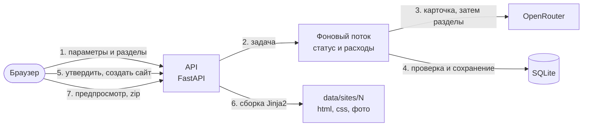

# TestGen

Панель, которая через OpenRouter придумывает B2B-компанию и собирает ей сайт. Сначала генерируется карточка: юрлицо, история, команда, контакты, продукт, FAQ, потом юридические документы, реквизиты, политика данных, безопасность, клиенты и кейсы. Карточку можно поправить руками и утвердить, после этого из неё собирается сайт на русском или немецком.

Проект тестовый. Компании из одной области (ИИ для инвестиционных исследований и анализа данных), страна Германия или Россия.

Все данные выдуманы. Реквизиты, телефоны и домены не настоящие, а юридические тексты это шаблоны, а не консультация юриста.

## Как это устроено



Всё строится от карточки компании, она хранится в JSON. Модель пишет только тексты. Город, индекс, улицу, телефон и почту подставляет код по правилам страны: телефон из кода города, индекс из диапазона города (в Германии 5 цифр, в России 6), домен почты из бренда. Так контакты не разъедутся с городом.

В карточке есть ядро (юрлицо, история, команда, контакты, продукт со сценариями и FAQ) и разделы: юридические документы, реквизиты, персональные данные, безопасность, клиенты. Каждый раздел это отдельный аспект. Его можно создать, пересоздать или удалить, не трогая остальное. Реквизиты собирает код, остальные разделы пишет модель, по запросу на раздел.

Сайт собирается без модели. Модель нужна, только если язык сайта не совпадает с языком карточки, тогда тексты переводятся, а имена, контакты, названия и числа остаются как есть. Вместе с сайтом сохраняется копия карточки, так что правка карточки старые версии сайта не меняет. Они получают пометку «карточку изменили после сборки», а для правок собирается новая версия. Открыть или скачать готовый сайт можно бесплатно.

Генерация идёт в фоне, панель показывает этап и сколько потрачено. Ответ модели проверяется схемой и проверками согласованности. Если что-то не так, модель получает свой ответ и причину и исправляет, но не больше `MAX_RETRIES` раз. Если раздел так и не получился или кончился лимит, готовое остаётся, а панель пишет, чего не хватает. Это можно догенерировать потом, за остальное второй раз платить не надо.

Стек: FastAPI, SQLAlchemy 2.0, Alembic, SQLite, Jinja2, httpx, Pillow. Интерфейс на обычном js, без сборки.

## Запуск

Нужен Python 3.12 или новее и ключ с [openrouter.ai/keys](https://openrouter.ai/keys) с положительным балансом.

```bash
cp .env.example .env
```

Ключ проще всего вписать в `.env` в `OPENROUTER_API_KEY=`, другие способы ниже в разделе «Ключ OpenRouter». Дальше либо Docker:

```bash
docker compose up --build
```

либо без него:

```bash
python -m venv .venv
.venv/Scripts/pip install -r requirements.txt
.venv/Scripts/uvicorn sitegen.main:app
```

Панель откроется на http://localhost:8000, документация API на http://localhost:8000/docs. Миграции накатываются сами при старте. Порт слушает только `127.0.0.1`, авторизации в панели нет.

## Панель

- «Компании»: список с ID, городом, масштабом, статусом и расходом.
- «Новая компания»: бренд, страна, направление, тип сервиса, масштаб, язык и какие разделы делать. Любой параметр можно оставить на «Случайно из каталога», а бренд не заполнять, тогда его придумает модель.
- Страница компании идёт по шагам: факты, разделы, фото команды, совместная проверка, утверждение. Сверху видно, сколько ушло на эту компанию.
- Редактор карточки разбит на вкладки: компания, предложение, история, команда, контакты, продукт, FAQ и по вкладке на раздел. Кнопка «Сохранить» всегда сверху.
- Под редактором создание сайта: язык, шаблон, цветовая схема, шрифт заголовков, модель и лимит для перевода. Ниже версии сайта с предпросмотром, архивом и удалением.
- «Сайты»: все версии всех компаний. «Ключ»: ключ OpenRouter.

У компаний и версий сайта шестизначные ID вместо порядковых номеров. В шапке общий расход, есть ли ключ и переключатель светлой и тёмной темы, по умолчанию тема как в системе.

Удаление спрашивает подтверждение. С компанией удаляются все её сайты и фото. Пока идёт генерация, удалять нельзя, а то задача потом допишет данные уже удалённой компании. Общий счётчик расходов считает то, что лежит в базе, так что удалённое из него тоже пропадает.

## Настройки

Всё в `.env`, пример в `.env.example`.

| Переменная | Что делает |
|---|---|
| `OPENROUTER_API_KEY` | ключ, без него генерация и перевод не работают |
| `OPENROUTER_API_KEY_FILE` | путь к файлу, в котором лежит только ключ |
| `USE_KEYRING` | брать ли ключ из хранилища учётных данных системы, по умолчанию да |
| `OPENROUTER_MODELS` | ещё модели к готовому списку в панели |
| `DEFAULT_MODEL` | модель по умолчанию |
| `DEFAULT_IMAGE_MODEL` | модель для фото команды по умолчанию |
| `MAX_COST_USD` | лимит на одну операцию по умолчанию, 0.10 |
| `MAX_COST_CAP_USD` | больше этого лимит из панели не примется, по умолчанию 5 |
| `MAX_RETRIES` | сколько раз повторять при ошибке сети или битом ответе, по умолчанию 2 |
| `REQUEST_TIMEOUT` | сколько секунд ждать OpenRouter, по умолчанию 120 |
| `DATABASE_URL`, `SITES_DIR`, `MEDIA_DIR` | где лежат база, сайты и фото |
| `DOCS` | показывать ли `/docs`, по умолчанию да |
| `LOG_JSON` | журнал в JSON, по умолчанию обычным текстом |
| `ALLOWED_HOSTS` | с каких адресов принимать запросы, по умолчанию `localhost,127.0.0.1` |

Модель и лимит выбираются в панели для каждой операции. В списке есть готовые модели с ценой и примерной стоимостью компании, а в «Другая модель» можно вписать любую из каталога OpenRouter. Лимит $0.05, $0.10, $0.50, $1 или свой, но не больше `MAX_COST_CAP_USD`. Последний выбор панель запоминает.

Стоимость берётся из `usage.cost` в ответе OpenRouter, а если его нет, считается по тарифу модели. Перед запросом `max_tokens` режется так, чтобы даже самый длинный ответ влез в остаток лимита. Если денег на нормальный ответ уже не хватает, запрос не уходит. Если тариф модели неизвестен, лимит проверяется только по факту перед следующим запросом.

Компания целиком это шесть запросов: карточка, четыре раздела и совместная проверка, реквизиты бесплатные. Перевод сайта ещё пять. На Claude Sonnet 5.5 компания с проверкой обошлась примерно в $0.40-0.55, фото на шесть человек на модели по умолчанию около $0.20.

## Ключ OpenRouter

Сервер берёт первый найденный ключ отсюда:

1. `OPENROUTER_API_KEY` в окружении или в `.env`;
2. файл из `OPENROUTER_API_KEY_FILE`, удобно для сервера и docker secrets;
3. хранилище учётных данных системы, на Windows это «Диспетчер учётных данных».

На своём компьютере удобнее третий вариант, тогда ключа в папке проекта нет вообще. Задать, заменить или удалить его можно на странице «Ключ» в панели. Перед сохранением ключ проверяется у OpenRouter, там же видны лимит и расход по нему. Если ключ задан через `.env` или файл, панель им не управляет, только показывает, откуда он взят. То же из терминала:

```bash
python -m scripts.set_key
```

Ввод не виден и не попадает в историю терминала. Удалить ключ из хранилища: `python -m scripts.set_key --delete`.

Ключ наружу не уходит. В ответах API вместо него подсказка вида `sk-or-...c3d4`, в журнал пишутся только модель, токены и стоимость. Если OpenRouter вдруг вернёт ключ в тексте ошибки, он заменяется на `***`. В архивы сайтов и JSON ключ тоже не попадает, это проверяют тесты.

На openrouter.ai ключу лучше сразу поставить лимит кредитов, тогда даже утёкший ключ больше этой суммы не потратит.

Чтобы ключ не попал в git, есть `python -m scripts.check_secrets`. Она ищет похожие на ключи строки во всех файлах проекта, включая ещё не закоммиченные, и ругается на `.env` в git. Работает и без git, если проект скачали архивом. Стоит в CI и в хуке перед коммитом, хук включается один раз:

```bash
git config core.hooksPath .githooks
```

## Направления из ТЗ

| № | Направление | Где |
|---|---|---|
| 1 | Оператор, история и команда | ядро: юрлицо, история, директор, два руководителя, сотрудники |
| 2 | Юридические документы | аспект `legal`: выходные данные и условия использования |
| 3 | Страновые реквизиты | аспект `requisites`, собирает код: для Германии суд, HRB, USt-IdNr, капитал, руководитель, для России ИНН, КПП, ОГРН, ОКВЭД, капитал, руководитель |
| 4 | Контакты | ядро: город, адрес, телефон, почта, собирает код |
| 5 | Продукт, сценарии и FAQ | ядро: входные данные, процесс, результат, ограничения, 3-4 сценария, 5 вопросов |
| 6 | Персональные данные | аспект `privacy`: что обрабатывается, основание, сроки, права, cookie, для России по 152-ФЗ |
| 7 | Безопасность | аспект `security`: меры защиты, работа с данными, что делаем при инциденте |
| 8 | Клиенты, отзывы, кейсы, публикации | аспект `references`, у публикаций свой текст, на сайте он раскрывается по клику |

## Сверх первого этапа

ТЗ на первом этапе просит Германию, два масштаба, сайт из трёх страниц, один шаблон и архитектуру под восемь направлений. Сверх этого сделано:

- все восемь направлений целиком, а не только задел под них, раздел каждого можно создать, пересоздать или удалить;
- вторая страна, Россия, со своими городами, телефонами, формами юрлица, правом и политикой по 152-ФЗ;
- страновые реквизиты для обеих стран, их собирает код, номера сходятся с карточкой (подробнее ниже);
- сайт до восьми страниц и три шаблона, к ним четыре цветовые схемы и два шрифта заголовков;
- утверждение в два этапа (сначала факты, потом весь комплект) и проверка кодом, что новая компания не пересказывает уже созданные;
- фото команды рисует модель изображений, у каждого человека свой образ;
- примеры с тремя вариантами сайта у каждой компании, все открываются по ссылкам на GitHub Pages.

## Страны

Всё, что зависит от страны, лежит в `COUNTRIES` в `catalog.py`: города с кодами телефонов и индексами, формат улицы, формы юрлица, зона домена, право для условий использования и профиль политики данных. Новая страна это новая запись там, код трогать не надо.

- Германия: восемь городов от Berlin до Leipzig, GmbH, UG и AG, Impressum, политика по GDPR.
- Россия: Москва, Санкт-Петербург, Казань, Новосибирск, Екатеринбург, Нижний Новгород, ООО и АО, «Сведения о компании», право РФ с претензионным порядком. Политика по 152-ФЗ сделана по структуре типовых политик: принципы и условия обработки, действия с данными, хранение и уничтожение, трансграничная передача, конфиденциальность, плюс Роскомнадзор, хранение данных на территории РФ и отзыв согласия.

В подвале каждой страницы две строки. Первая про оферту, она своя у страны: «Информация, размещенная на сайте, не является публичной офертой» для России и «kein verbindliches Angebot» для Германии. Вторая говорит, что сайт демонстрационный: «Сайт создан для демонстрации. Компания, люди и реквизиты вымышлены, информация носит исключительно ознакомительный характер», на немецком «Diese Website dient nur zur Demonstration. Unternehmen, Personen und Angaben sind fiktiv». Язык обеих строк берётся по языку сайта.

## Страновые реквизиты

Реквизиты собирает код, ключ для них не нужен. Номера в формате страны и сходятся с карточкой: суд по городу, регион в ИНН, КПП и ОГРН по городу, год в ОГРН это год основания, КПП из той же инспекции, что ИНН, капитал не меньше минимума для формы юрлица (GmbH 25 000 EUR, UG 1 EUR, AG 50 000 EUR, ООО 10 000 ₽, АО 100 000 ₽), руководитель это директор из команды. Пересоздание даёт те же номера.

Чтобы номер случайно не совпал с настоящей фирмой, контрольная цифра у ИНН, ОГРН и USt-IdNr специально неверная, проверка это контролирует. У HRB контрольной цифры нет, поэтому берутся номера от 900000, таких ещё не выдавали. В других разделах модели писать номера из реестров нельзя, они есть только в реквизитах.

## Как добавить новый аспект

1. Создать `sitegen/aspects/<имя>.py` со схемой раздела и подклассом `Aspect`. В нём ключ, название, схема, пример JSON для модели, `prompt(ctx)`, проверки `check(ctx, data)`, страницы сайта, какие поля переводить, подписи для панели, строки шаблона и `check_site` для готовой страницы. Если раздел зависит от другого, это `requires`. Если раздел собирает код, как реквизиты, нужны `by_code = True` и `build()` вместо `prompt()`.
2. Положить шаблон `sitegen/templates/site/<файл>.html`. Он наследует `base.html` и получает `c` (карточка на языке сайта), `facts` (неизменные факты), `t` и `ta` (строки), `section` (данные раздела) и `ptitle`.
3. Добавить `<Имя>Aspect()` в `sitegen/aspects/__init__.py`.

После этого раздел сам появится в форме новой компании, на странице компании, в переводе, в проверках, на сайте и в схеме данных. Тест `test_new_aspect_works_end_to_end` в `tests/test_aspects.py` так и подключает выдуманный аспект.

## Структура

`routes` принимают запросы, логика в `core`, и commit делает тоже `core`. Запросы к базе только в `repositories`, во внешние сервисы ходит `clients`.

```
sitegen/
  routes/         http: компании и разделы, сайты и предпросмотр, конфиг и задачи
  core/           генерация, разделы, проверки, перевод, сборка сайта
  aspects/        разделы: реестр, база и аспекты 2, 3, 6, 7, 8
  repositories/   запросы к базе
  clients/        openrouter
  background/     фоновые задачи
  templates/site/ шаблоны сайта и css
  web/            панель
  card.py         схема карточки
  catalog.py      страны, направления, типы сервисов, масштабы
migrations/       alembic
tests/            pytest, вместо OpenRouter заглушка, карточки в tests/fixtures
examples/         две готовые компании с фото и тремя сайтами у каждой
scripts/          схема данных, сборка примеров, ключ и проверка на ключи
docs/             company.schema.json
```

## Данные компании

Схема лежит в [docs/company.schema.json](docs/company.schema.json), она собирается из моделей в `sitegen/card.py` и в аспектах. Пересобрать: `python -m scripts.export_schema`.

В ядре бренд и юрлицо, контакты, директор, два руководителя и минимум два сотрудника (на сайте нужно не меньше пяти человек), история и специализация, аудитория и проблема клиента, продукт со сценариями и пять вопросов. Разделы лежат в `sections`. Отпечатки утверждений и результат совместной проверки хранятся отдельно, в столбце `meta`.

## Шаблоны сайта

Три шаблона, к каждому подходят все четыре цветовые схемы и оба шрифта заголовков:

- «Классический»: тёмный первый экран и карточки на светлом фоне;
- «Журнальный»: светлый фон, заголовки с засечками, тонкие линейки;
- «Тёмный»: почти чёрный фон и градиент из цветов схемы.

Шаблон это папка `sitegen/templates/site/themes/<ключ>/` со своим `style.css.j2`, а если надо, то и со своими страницами, всё остальное берётся из общих. Новый шаблон: папка и строка в `THEMES` в `sitegen/core/builder.py`. Проверки сайта от вёрстки не зависят.

Анимации только на CSS, скриптов на сайтах нет совсем. Если в системе включено «уменьшить движение», анимаций тоже нет.

## Фото команды

По ТЗ у каждого человека на сайте должно быть фото. Портреты рисует модель изображений из OpenRouter, по имени и должности. В запросе сказано, что человек вымышленный, похожим на реальных людей быть не должен, текста и логотипов на фото нет. Чтоб команда не выглядела как с одной съёмки, у каждого своя одежда, фон, поза, выражение лица и свет, у директора одежда построже. Картинка обрезается до 512×512 и сохраняется в JPEG.

Фото делаются после утверждения фактов, у них свой выбор модели и лимит. Одно стоит примерно $0.01-0.05, на всю команду лучше ставить $0.50. По умолчанию рисуются только недостающие, можно перерисовать одного человека или всех. Фото привязано к имени и должности, правка биографии его не сбрасывает и утверждение не снимает. Пока фото нет, на сайте стоит силуэт.

## Утверждение по шагам

1. Генерация делает только общие факты: юрлицо, историю, команду, контакты, продукт, сценарии, FAQ.
2. Факты утверждаются кнопкой «Утвердить факты», без этого разделы не создаются.
3. Разделы пишутся по утверждённым фактам. Каждый видит все факты и коротко уже готовые разделы, чтоб не разойтись с ними в сроках и обещаниях. После разделов сама запускается совместная проверка.
4. Утвердить весь комплект можно, только если факты утверждены, проверка кодом чистая, а проверка моделью пройдена для текущей версии карточки. Сайт собирается только из утверждённого.

Статус считается по отпечаткам данных, руками его никто не ставит. Правка фактов снимает утверждение, а разделы помечаются как созданные по старым фактам. Пока их не пересоздали, комплект не утвердить. Кнопка «Создать и обновить разделы» пересоздаёт и недостающие, и устаревшие. Правка одного раздела факты не трогает, но комплект надо проверить заново.

## Чтобы компании не повторялись

Для каждой генерации код выбирает «зерно»: город, форму юрлица, год, число сотрудников, нишу и тип основателя. Всё это уходит в запрос, так что при одинаковых параметрах компании получаются разными по сути, а не только по именам. Ещё в запрос идёт список уже созданных компаний с просьбой их не повторять, а одинаковый бренд не пройдёт.

Модель может и не послушаться, поэтому ответ сравнивается с уже созданными компаниями на том же языке. Это делает код, без платных запросов. Сравниваются история, специализация, предложение, биографии команды, продукт и FAQ, а имена людей, бренд и название продукта перед этим вырезаются. Иначе копия с другими именами сошла бы за новую компанию.

Считается доля общих слов и доля общих троек слов подряд. Первая ловит тот же сюжет, вторая переписанные куски. От 45% общих слов или 15% общих фраз модель получает замечание и переписывает. Пороги подбирал по созданным карточкам: у разных компаний выходило до 30% слов и 5% фраз, у пересказа 90% и 80%. Та же проверка стоит на утверждении фактов, на случай если карточку поправили руками. Код в `sitegen/core/similarity.py`.

## Проверки

Ядро карточки:
- телефон, индекс и домен почты подходят к городу и бренду;
- в истории есть год основания, в юрлице выбранная форма;
- имена не повторяются, состав команды правильный;
- нет пустых полей и недозаменённых шаблонов вроде `{{ x }}`, `{city}`, `[город]`;
- тексты не обещают того, чего на сайте нет: кабинета, регистрации, загрузки файлов, форм.

Фраза с отрицанием («кабинета нет») и похожие слова в другом смысле («компания зарегистрирована», «Patente anmelden») проверку проходят.

Числа и город в текстах о компании должны совпадать с карточкой. Если в истории написано про 40 сотрудников, а в карточке 29, это ошибка, как и другой город в истории.

Разделы сверяются с фактами при генерации, правке, пересоздании и утверждении:

- юридические документы: представитель это директор, есть юрлицо, название продукта и право страны, нет номеров из реестров;
- персональные данные: основание по закону страны, нет обработки того, чего на сайте нет, назван оператор, для России всё, что нужно по 152-ФЗ;
- безопасность: нет сертификатов и обещаний абсолютной защиты;
- реквизиты: формат страны и связь с городом, годом, формой юрлица и директором;
- клиенты и кейсы: отзывы и кейсы про клиентов из списка, авторы отзывов не из команды, авторы публикаций из команды, годы не раньше основания;
- везде: нет обещаний доходности, ссылок и остатков шаблонов.

Готовый сайт проверяется перед сохранением: все страницы на месте, у каждой заголовок, описание, favicon и язык, навигация ведёт на все страницы, бренд, юрлицо, телефон и почта одинаковые везде, в подвале обе строки, вся команда с фото на странице контактов, на продукте все вопросы и сценарии, на главной все преимущества, плюс проверки страниц разделов. Если что-то не прошло, версия не создаётся.

Смысловые противоречия кодом не поймать: в FAQ срок 2 дня, а в условиях 10, или кейс обещает то, чего продукт не умеет. Для этого совместная проверка моделью. Ей уходит карточка целиком, а возвращается список противоречий: где, в чём и как исправить. Пока код находит ошибки, модель не вызывается.

При переводе проверяется, что поля те же, числа на месте, длина похожая, а бренд, продукт, имена людей и клиентов остались как были. Потом переведённая карточка проходит те же проверки, что и исходная.

## Чего нет

Формы обратной связи, кабинета, загрузки файлов и серверной обработки на сайтах нет, и нигде не написано, что они есть. На странице контактов прямо сказано, что формы нет, и политика данных описывает именно такой сайт. Скриптов на сайтах тоже нет, в предпросмотре они запрещены через CSP.

Клиентов и авторов отзывов придумывает модель. Проверить, что такое название не совпало с реальной фирмой, код не может, так что перед публикацией это стоит просмотреть.

## Тесты

```bash
.venv/Scripts/pip install -r requirements-dev.txt
```

```bash
.venv/Scripts/pytest --cov
```

```bash
.venv/Scripts/ruff check .
```

```bash
.venv/Scripts/mypy
```

В тестах к OpenRouter никто не ходит: клиент гоняется на подставном транспорте, остальное на заглушке модели. База во временной папке.

## Примеры

В `examples/` две компании, сделанные на Claude Sonnet 5.5, с фото команды и тремя вариантами сайта у каждой:

- `zitara`: Zitara UG из Кёльна, небольшая, ИИ-отчёты по патентным данным для технологических инвесторов. Карточка и сайты на немецком.
- `lavirt`: ООО «Лавирт» из Казани, средняя, аналитика коммерческой недвижимости, где модели работают вместе с аналитиками. Карточка и сайты на русском.

Все сайты выложены на GitHub Pages, оглавление тут: https://vitaliandr.github.io/Test_gen/

| | Классический | Журнальный | Тёмный |
|---|---|---|---|
| Zitara | [открыть](https://vitaliandr.github.io/Test_gen/zitara/site-classic/) | [открыть](https://vitaliandr.github.io/Test_gen/zitara/site-editorial/) | [открыть](https://vitaliandr.github.io/Test_gen/zitara/site-dark/) |
| Лавирт | [открыть](https://vitaliandr.github.io/Test_gen/lavirt/site-classic/) | [открыть](https://vitaliandr.github.io/Test_gen/lavirt/site-editorial/) | [открыть](https://vitaliandr.github.io/Test_gen/lavirt/site-dark/) |

Выкладывает их `.github/workflows/pages.yml` при каждом изменении в `main`.

В папке компании `company.json`, фото в `photos/` и сайты в `site-classic/`, `site-editorial/` и `site-dark/`. Локально сайт открывается через `index.html` в его папке, сервер не нужен. Пересобрать сайты: `python -m scripts.build_examples`.

Тесты используют свои карточки из `tests/fixtures`, так что примеры можно менять спокойно.
